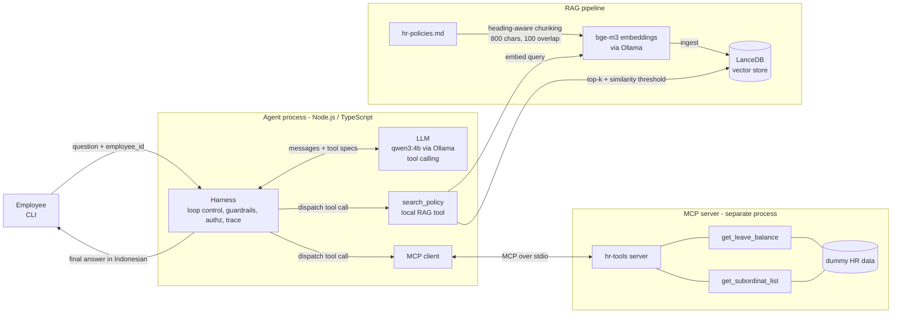

# HR Assistant Agent (RAG + MCP + Tool Calling)

An internal HR chatbot that answers employee questions from HR policy documents (RAG) and calls live tools through the Model Context Protocol (MCP) to check leave balances and reporting lines. Everything runs locally on Ollama: no cloud account, no API key.

## Quick start

Prerequisites: Node.js 22+, [Ollama](https://ollama.com).

```bash
ollama pull qwen3:4b      # chat model (tool calling)
ollama pull bge-m3        # multilingual embedding model
npm install
cp .env.example .env      # optional, defaults work

npm run ingest                                   # chunk + embed + store the sample HR doc
npm run chat -- --employee-id E002               # interactive CLI (prints a trace of every step)
npm run chat -- --employee-id E002 --ask "Sisa cuti saya berapa?"
npm run eval                                     # run the mini eval suite
```

Dummy employees (`src/mcp-server/data.ts`): `E001` Head of Engineering, `E002` Engineering Manager (reports to E001; has E003, E004, E005), `E006` HR Generalist (reports to E001).

Example session as `E002`:

```
> Sisa cuti saya berapa hari, dan apa aturan carry over-nya?
  [1] tool_call get_leave_balance {"employee_id":"E002"}
  [1] tool_call search_policy {"query":"aturan carry over sisa cuti"}
  [2] final answer
```

## 1. Architecture



### How the agent decides: RAG vs MCP tool

There is no hand-written router. The LLM sees three tools with descriptions and picks one per step (function calling):

| Question type | Example | Tool the LLM picks |
|---|---|---|
| Rules, procedures, benefits (static text) | "Boleh WFH berapa hari seminggu?" | `search_policy` (RAG) |
| Live per-employee data | "Sisa cuti saya berapa?" | `get_leave_balance` (MCP) |
| Org structure | "Siapa bawahan saya?" | `get_subordinat_list` (MCP) |
| Needs several | "Siapa di tim saya yang cutinya paling sedikit?" | `get_subordinat_list`, then `get_leave_balance` per person |
| Not covered anywhere | "Berapa gaji CEO?" | `search_policy` returns nothing relevant, so the agent says it does not know |

The harness (not the LLM) enforces the things that must not depend on model behaviour: iteration cap, duplicate-call detection, authorization, and the similarity threshold.

### Component choices

**LLM: `qwen3:4b` on Ollama.** HR documents are internal, so keeping inference local avoids sending employee data to a third party, and it needs no API key for the take-home. Qwen3 supports native tool calling and handles Indonesian acceptably at a size that runs on a CPU-only laptop. The model name is an env var, so moving to a larger local model (`qwen2.5:7b`) or a hosted one is a config change in `src/agent/llm.ts`.

**Embeddings: `bge-m3` (via Ollama).** The corpus and the questions are Indonesian; `bge-m3` is multilingual and strong on retrieval benchmarks, while English-centric models such as `nomic-embed-text` retrieve noticeably worse on Indonesian text. Serving it through Ollama keeps a single runtime to install.

**Vector store: LanceDB.** It is embedded (a folder on disk, no server), supports cosine search and metadata, and installs with npm. Chroma needs a separate server and pgvector needs Postgres, which is overhead for a 200-page corpus (a few thousand chunks). For production I would move to pgvector so vectors live next to the existing relational data, with row-level access control and backups handled by the existing database operations.

**Agent framework: none (hand-written loop).** The task asks for loop and harness engineering, and a ~100 line loop is easier to reason about, trace, and test than a framework abstraction. The tool interface (name, description, JSON schema) is the same one a framework would use.

**MCP over stdio.** The agent spawns the server as a child process and talks to it only through the MCP protocol (`listTools`, `callTool`), never by importing its functions. Swapping to a remote server later only changes the transport.

## 2. RAG pipeline

`src/rag/`: `chunk.ts` → `ollama.ts` (embed) → `store.ts` (LanceDB) → `retrieve.ts` (top-k).

- **Chunking:** split on Markdown headings, then on sentence boundaries when a section exceeds 800 characters, with 100 characters of overlap. The heading path ("Cuti > Cuti Tahunan") is stored as metadata and prefixed to the chunk text.
- **Retrieval:** embed the query, cosine top-k (`TOP_K=4`), then drop chunks below `MIN_SIMILARITY`. An empty result is the "not in the documents" signal.

## 3. MCP server

`src/mcp-server/server.ts` exposes two tools backed by in-memory dummy data:

- `get_leave_balance(employee_id)` returns remaining and taken leave days.
- `get_subordinat_list(employee_id)` returns direct reports.

Run alone with `npm run mcp-server` (stdio, for use with any MCP client).

## 4. Agent, harness, and loop engineering

`src/agent/harness.ts` is the use case for harness and loop engineering. The loop is *think → act → observe*, and the harness controls it:

| Concern | What the harness does |
|---|---|
| Runaway loops | Hard cap `MAX_AGENT_ITERATIONS` (default 5), then a safe fallback answer |
| Repeated calls | The same tool with identical arguments twice is blocked, and the model is told to use the earlier result |
| Transient failures | One retry for LLM and tool errors |
| Ungrounded answers | If the model answers without calling any tool, it is nudged once to use one |
| Hallucination | `search_policy` returns `found=false` below the similarity threshold, and the system prompt requires the fixed "tidak tahu" reply |
| Authorization | Before `get_leave_balance` or `get_subordinat_list` runs, the harness walks the requester's downline through MCP. Employees can only read themselves and their subordinates; anything else is blocked and the model is told access was denied |
| Observability | Every iteration, tool call, result, block, and retry is printed as a trace line |

Authorization lives in the harness on purpose: a prompt instruction ("do not reveal other people's data") can be bypassed by prompt injection, a code check cannot.

## 5. Trade-offs

- **Chunk size 800 chars / 100 overlap.** Policy sections are short and self-contained, so one chunk usually holds one rule with its numbers. Larger chunks dilute the embedding with unrelated rules and waste context on a small model; smaller chunks separate a rule from its exception. Heading-aware splitting avoids cutting a rule in half. The cost is some duplicated text from overlap.
- **Top-k = 4 with a threshold.** Enough to cover a question that spans two sections, small enough for a 4B model's context. The threshold trades recall for safety: a higher value means more "tidak tahu" for borderline questions, which I prefer to a confident wrong answer in an HR context.
- **Small local model.** Cheap, private, and offline, but weaker at multi-step tool use and Indonesian fluency than a hosted frontier model. The harness limits the damage (loop caps, authz in code), and the eval suite is how I would measure whether a bigger model is worth the cost.
- **RAG as a tool instead of always-retrieve.** Letting the model decide saves a retrieval on pure data questions and supports multi-step use, but a weak model may skip retrieval. The nudge and eval cases cover this.
- **LanceDB over pgvector.** Zero setup for the demo; less suited to multi-user production with access control.
- **No conversation memory beyond final turns.** Tool chatter is dropped between turns to keep the context small.

## 6. Evaluation

### What runs today (`npm run eval`)

13 cases in `src/eval/cases.ts` with rule-based checks (no LLM judge, so results are deterministic to inspect):

- **Retrieval:** the right section is in the relevant top-k; an off-topic query returns nothing.
- **RAG answers:** correct fact appears (e.g. "12" for annual leave) and `search_policy` was called.
- **Tool routing:** correct MCP tool chosen; multi-tool question uses both.
- **Guardrail:** out-of-scope questions get "tidak tahu" and call no data tool.
- **Authorization:** an employee cannot read their manager's balance; a manager can read an indirect report's.

### What I would add in production

1. **Retrieval metrics on a labelled set:** recall@k and MRR over several hundred real questions mapped to their source sections, tracked per chunking/embedding change.
2. **Groundedness / faithfulness:** an LLM-as-judge (calibrated against a human-labelled sample) checking that every claim in the answer is supported by the retrieved passages, plus citation accuracy.
3. **Answer correctness:** golden Q&A pairs reviewed by HR, scored by judge + exact match on numbers and dates.
4. **Tool-use accuracy:** correct tool, correct arguments, and no unnecessary calls, measured on recorded traces.
5. **Abstention quality:** precision/recall of "tidak tahu" on a set of answerable vs unanswerable questions (the false-confident-answer rate is the headline safety metric).
6. **Safety and authz red-team set:** prompt-injection attempts, requests for other employees' data, and attempts to bypass the tool allowlist; target is zero leaks.
7. **Regression gate in CI:** run the suite on every prompt, model, chunking, or document change and block merges that drop key metrics.
8. **Online signals:** thumbs up/down, "talked to HR anyway" rate, unanswered-question logs (these become new eval cases and show document gaps), latency and cost per answer, tool error rate.
9. **Doc freshness:** re-ingest on document change and re-run retrieval evals so stale policies are not served.

## Project layout

```
data/hr-policies.md        sample HR document (Indonesian, fictional)
src/config.ts              env-driven settings
src/rag/                   chunk, embed, store, retrieve, ingest
src/mcp-server/            MCP server + dummy data
src/agent/                 LLM client, MCP client, tools, harness, CLI
src/eval/                  eval cases and runner
```
