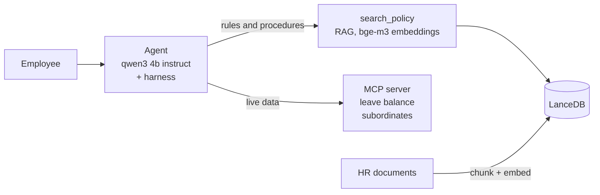

# HR Assistant Agent

A chatbot that answers employee HR questions from policy documents (RAG) and looks up live data like leave balance (MCP tools). It runs fully on your machine: no cloud, no API key.

```bash
ollama pull qwen3:4b-instruct && ollama pull bge-m3    # needs Node.js 22+ and Ollama
npm install && npm run ingest                          # load the HR document into the vector store
npm run chat -- --employee-id E002                     # talk to it (add --ask "..." for one question)
npm run eval                                           # 33 automatic checks, ~50 s
npm run ui                                             # optional browser demo at http://localhost:4310
```

## Architecture



**RAG or MCP?** The model chooses from the tool descriptions: `search_policy` for rules, MCP for a person's data, both when the question needs both. If it answers without calling any tool, the harness steps in (see below).

**Why each component:**

- **qwen3:4b-instruct on Ollama.** HR data never leaves the machine, and there is no API key or usage cost. It is a small model and makes mistakes, so the harness checks its work.
- **bge-m3.** It is an open-source multilingual model, which suits Indonesian documents and mixed-language questions. Correct chunks scored 0.617-0.748 and off-topic ones 0.310-0.564, a clean gap for a threshold.
- **LanceDB.** It is embedded and file-based, so a demo needs no database server. I would move to pgvector in production to keep access control and backups next to existing data.
- **MCP over stdio.** The agent starts the server as a child process, so there is no port or auth to set up. The tools can later move to a real HR system without changing the agent.

## Harness and Loop Engineering

Use case: the agent must never answer without evidence and never spin forever. These rules live in code, not in the prompt, and are tested with a scripted model.

- **Iteration cap:** 5 rounds, then a safe fallback reply.
- **Grounding:** an answer with no tool call gets one nudge; if the model ignores it, the harness runs the document search itself.
- **Loop guard:** an identical repeated tool call is refused.
- **Failures:** 120 s model and 30 s tool timeouts, with one retry.
- **Access control:** before a data tool runs, the harness checks the target is the asker or someone in their team.
- **"Don't know" guardrail:** if nothing backs the answer, it is replaced with a fixed "not covered, contact HR" reply.

## Trade-offs

- **Chunks of 800 characters, 100 overlap, cut at headings.** Keeps one rule with its numbers; costs a little repeated text.
- **Relevance threshold 0.59, near misses (0.50-0.59) double-checked by the model.** Colloquial and off-topic questions score too close for a plain cut-off. I prefer a wrong "not covered" over a confident wrong answer.
- **Sample corpus, not 200 pages.** The demo uses one 5 KB Markdown file. The real corpus needs a PDF text-extraction step, a re-measured threshold, and likely a reranker.

## Evaluation

`npm run eval` runs 33 checks (right section, right fact, right tool, follow-ups, typos, polite refusal, access blocked). All pass. It is a smoke test, not a benchmark.

For production I would add: retrieval quality (recall@k, MRR), groundedness (judge model), HR-reviewed correctness, refusal rate, a red team for data leaks (target: zero), all in CI, plus user feedback tracking.
