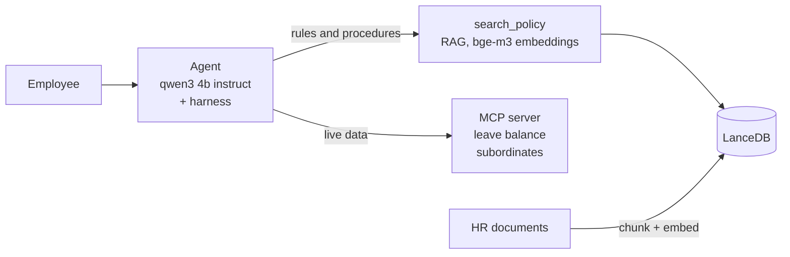

# HR Assistant Agent

An HR chatbot that answers from policy documents (RAG) and looks up leave balance and subordinates (MCP). It runs fully local.

```bash
ollama pull qwen3:4b-instruct && ollama pull bge-m3    # needs Node.js 22+ and Ollama
npm install && npm run ingest
npm run chat -- --employee-id E002
npm run eval                                           # 33 checks, ~50 s
```

## Architecture



**RAG or MCP?** The model chooses from the tool descriptions: `search_policy` for rules, MCP for a person's data, both when needed.

- **qwen3:4b-instruct on Ollama:** HR data stays on the machine, with no API key or usage cost. It is a small model that makes mistakes, so the harness checks its work.
- **bge-m3:** An open-source multilingual model that suits Indonesian documents. Correct chunks scored clearly above off-topic ones, which makes a threshold workable.
- **LanceDB:** Embedded and file-based, so the demo needs no database server. Production would move to pgvector for access control and backups.
- **MCP over stdio:** The agent starts the server as a child process, so there is no port or auth to set up. The tools can later move to a real HR system without changing the agent.

## Harness and Loop Engineering

The loop stops after 5 iterations with a safe fallback, refuses repeated tool calls, and retries a failed call once. If the model answers without evidence, the harness searches the documents itself; if nothing is found, it replies "not covered, contact HR". Access to another employee's data is checked in code before the tool runs.

## Trade-offs

- **800-character chunks, 100 overlap, cut at headings:** keeps a rule with its numbers, at the cost of some repeated text.
- **Similarity threshold 0.59:** I prefer a wrong "not covered" over a confident wrong answer.
- **5 KB sample corpus:** 200 pages of PDF would need text extraction and a re-measured threshold.

## Evaluation

`npm run eval` runs 33 smoke checks, and all pass. In production I would add recall@k, groundedness, HR-reviewed correctness, refusal rate, and a data-leak red team, all in CI.
