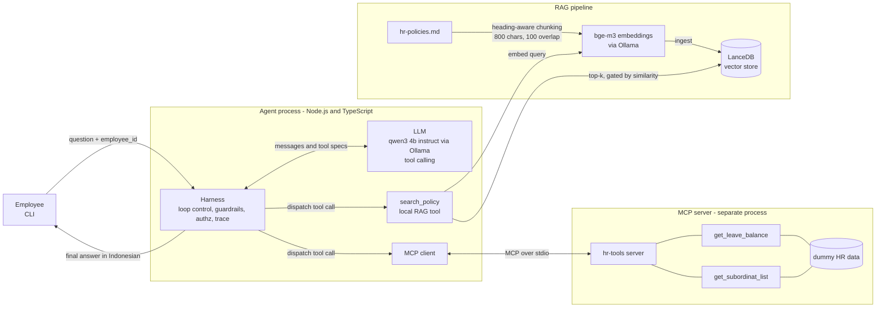

# HR Assistant Agent (RAG + MCP + Tool Calling)

An internal HR chatbot that answers employee questions from HR policy documents (RAG) and calls live tools through the Model Context Protocol (MCP) to check leave balances and reporting lines. Everything runs locally on Ollama: no cloud account, no API key.

## Quick start

Prerequisites: Node.js 22+ and [Ollama](https://ollama.com). Tested on Node 24 / Windows 11, CPU-class hardware with 15 GB RAM.

```bash
ollama pull qwen3:4b-instruct   # chat model (tool calling, non-thinking)
ollama pull bge-m3              # multilingual embedding model
npm install
cp .env.example .env            # optional, the defaults already work

npm run ingest                                   # chunk + embed + store the sample HR document
npm run chat -- --employee-id E002               # interactive CLI, prints a trace of every step
npm run chat -- --employee-id E002 --ask "Sisa cuti saya berapa?"
npm run eval                                     # mini eval suite against the real models (~15 s)
npm test                                         # unit + integration tests (needs Ollama + ingest)
```

Dummy employees (`src/mcp-server/data.ts`): `E001` Head of Engineering; `E002` Engineering Manager (reports to E001, manages E003, E004, E005); `E006` HR Generalist (reports to E001).

### A real session

Output of `npm run chat -- --employee-id E002`, answers in Indonesian (grey trace lines shortened):

```
> Boleh WFH berapa hari seminggu?
  [1] tool_call search_policy {"query":"aturan kerja dari rumah berapa hari seminggu"}
  [2] final answer
Karyawan boleh bekerja dari rumah maksimal 2 hari per minggu, yaitu Selasa, Rabu, atau Kamis.
Senin dan Jumat wajib bekerja dari kantor kecuali ada persetujuan khusus dari kepala divisi.

> Sisa cuti saya berapa hari, dan apa aturan carry over-nya?
  [1] tool_call get_leave_balance {"employee_id":"E002"}
  [1] tool_call search_policy {"query":"aturan carry over cuti tahunan"}
  [2] final answer
Sisa cuti ... 7 hari. Aturan carry over: sisa cuti dapat dibawa ke tahun berikutnya maksimal 5 hari,
harus dihabiskan paling lambat 31 Maret, jika tidak maka hangus.

> Berapa gaji CEO perusahaan ini?
  [1] answered without any tool -> nudging once
  [2] still no tool -> harness runs search_policy {"query":"<previous question> Berapa gaji CEO perusahaan ini?"}
  [3] final answer
Maaf, saya tidak tahu. Informasi itu tidak ada di dokumen HR yang saya miliki.
```

And as `E003` (a team member) asking for the leave of `E001`, a person outside their reporting line:

```
> Berapa sisa cuti E001?
  [1] tool_call get_leave_balance {"employee_id":"E001"}
  [1] BLOCKED get_leave_balance: E003 may not access E001
  [1] tool_result {"error":"Access denied. You may only view yourself and your own subordinates."}
  [2] final answer
Anda tidak memiliki akses untuk melihat data cuti untuk E001. ...
```

## 1. Architecture



### How the agent decides: RAG vs MCP tool

There is no hand-written router. The LLM sees three tools with descriptions and picks one per step (function calling). The RAG search is wrapped as a local tool, so "look it up in the documents" and "ask the HR system" are one decision with the same interface.

| Question type | Example | Tool the LLM picks |
|---|---|---|
| Rules, procedures, benefits (static text) | "Boleh WFH berapa hari seminggu?" | `search_policy` (RAG) |
| Live per-employee data | "Sisa cuti saya berapa?" | `get_leave_balance` (MCP) |
| Org structure | "Siapa bawahan saya?" | `get_subordinat_list` (MCP) |
| Needs several | "Siapa di tim saya yang cutinya paling sedikit?" | `get_subordinat_list`, then `get_leave_balance` per person |
| Both a rule and live data | "Sisa cuti saya berapa, dan apa aturan carry over-nya?" | `get_leave_balance` and `search_policy` in one step |
| Not covered anywhere | "Berapa gaji CEO?" | `search_policy` finds nothing relevant, so the agent says it does not know |

The harness (not the LLM) enforces what must not depend on model behaviour: iteration cap, duplicate-call detection, authorization, the similarity gate, and a forced document search when the model skips it (section 4).

### Component choices

**LLM: `qwen3:4b-instruct` on Ollama.** HR documents are internal, so keeping inference local avoids sending employee data to a third party, and it needs no API key. Qwen3 supports native tool calling and handles Indonesian acceptably at a size that runs on a laptop, answering in roughly one to three seconds per question. Use the `-instruct` variant: the plain `qwen3:4b` tag now points to a thinking build that ignores `think: false` and `/no_think`, writes its reasoning into the answer, and was about 15x slower in my tests (78 s versus 5 s for one question). The model name is an env var, and a hosted model would be a one-file change in `src/agent/llm.ts`.

**Embeddings: `bge-m3` (via Ollama).** The corpus and the questions are Indonesian; `bge-m3` is multilingual and strong on retrieval benchmarks, while English-centric models such as `nomic-embed-text` retrieve noticeably worse on Indonesian text. Serving it through Ollama keeps a single runtime to install. On this corpus it put the correct section at rank 1 for 20 of 20 in-scope test questions (formal, colloquial and keyword style).

**Vector store: LanceDB.** It is embedded (a folder on disk, no server), supports cosine search and metadata, and installs with npm. Chroma needs a separate server and pgvector needs Postgres, which is overhead for a 200-page corpus (a few thousand chunks). For production I would move to pgvector so vectors live next to the existing relational data, with row-level access control and backups handled by the existing database operations.

**Agent framework: none (hand-written loop).** The task asks for loop and harness engineering, and a harness of under 200 lines is easier to reason about, trace, and test than a framework abstraction. The tool interface (name, description, JSON schema) is the same one a framework would use.

**MCP over stdio.** The agent spawns the server as a child process and talks to it only through the MCP protocol (`listTools`, `callTool`), never by importing its functions. Swapping to a remote server later only changes the transport.

## 2. RAG pipeline

`src/rag/`: `chunk.ts` → `ollama.ts` (embed) → `store.ts` (LanceDB) → `retrieve.ts` (top-k).

- **Chunking:** split on Markdown headings, then on sentence boundaries when a section exceeds 800 characters, with 100 characters of overlap. The heading path ("Cuti > Cuti Tahunan") is stored as metadata and prefixed to the chunk text so each chunk keeps its context. The sample document yields 17 chunks, all single sections of at most 452 characters; the split-and-overlap path is covered by a unit test on a synthetic long section instead.
- **Retrieval:** embed the query, take the cosine top-k (`TOP_K=4`). The **best chunk is the relevance gate**: if its similarity is below `MIN_SIMILARITY=0.59`, nothing is returned and the agent answers "tidak tahu". Once the gate passes, all top-k chunks are returned, because the 2nd to 4th chunks of a multi-section question usually score under the threshold themselves and would be dropped by a per-chunk filter.
- **Threshold, measured not guessed:** correct chunks scored 0.617 to 0.748 (20 queries), the best chunk of out-of-scope questions scored 0.310 to 0.564 (6 queries). 0.59 is the midpoint of that gap. The gap is narrow (about 0.03 on each side), so it must be re-measured when documents or models change.

## 3. MCP server

`src/mcp-server/server.ts` exposes exactly two tools backed by in-memory dummy data:

- `get_leave_balance(employee_id)` returns remaining and taken leave days.
- `get_subordinat_list(employee_id)` returns direct reports.

Unknown employees return a tool-level error, and IDs are normalised (case, whitespace). Run alone with `npm run mcp-server` (stdio, for any MCP client).

## 4. Agent, harness, and loop engineering

`src/agent/harness.ts` is the harness and loop engineering use case. The loop is *think → act → observe*, and the harness controls it. Every control below is proven by a test that forces it with a scripted model (`src/agent/loop-controls.test.ts`, `harness.test.ts`).

| Concern | What the harness does |
|---|---|
| Runaway loops | Hard cap `MAX_AGENT_ITERATIONS` (default 5), then a safe fallback answer that points to the HR team |
| Repeated calls | The same tool with identical arguments twice is not executed again; the model is told to use the earlier result |
| Stuck model or tool | Hard timeouts: `REQUEST_TIMEOUT_MS` (default 120 s, generous for a cold CPU model load) on every Ollama call and `TOOL_TIMEOUT_MS` (default 30 s) on every MCP call |
| Transient failures | One retry for LLM and tool errors (timeouts included), then a clear error (the CLI prints it and keeps the session alive) |
| Skipped retrieval | If the model answers without calling any tool, it is nudged once; if it still does not, the harness runs `search_policy` itself and feeds the result back. Pure small talk ("halo", "terima kasih") is exempt. If the iteration cap leaves no room to read that result, the unverified answer is dropped and the safe fallback is returned instead |
| Hallucination | `search_policy` returns `found=false` below the similarity gate, and the system prompt requires the fixed "tidak tahu" reply |
| Authorization | Before `get_leave_balance` or `get_subordinat_list` runs, the harness walks the requester's downline through MCP. Employees can only read themselves and their subordinates (direct and indirect); anything else is blocked and the model is told access was denied |
| Conversation memory | Earlier turns are passed as one system note, not as replayed chat turns (see below). A forced search for a follow-up prepends the previous question so the retriever has a topic |
| Observability | Every iteration, tool call, result, block, and retry is printed as a trace line |

Authorization lives in the harness on purpose: a prompt instruction ("do not reveal other people's data") can be bypassed by prompt injection, a code check cannot.

**Scope of the access control:** it protects against the *model* leaking data, not against a user lying about who they are. In this demo the identity is just the `--employee-id` flag, so anyone can type `E001`. In production the harness would receive the employee ID from the authenticated session (SSO / signed token) and never from user input; the check itself stays the same.

### What running it against the real model taught me

The first version looked fine on paper. These failures only showed up with the real 4B model, and each fix is backed by a measurement:

1. **Thinking model leaks reasoning** into answers and is ~15x slower. Fixed by using the instruct variant; a reply stripper remains as a safety net.
2. **The model says "tidak tahu" without searching.** A prompt rule alone did not stop it, so the harness nudges once and then runs the search itself (the forced retrieval above). This turned a confident wrong refusal into a grounded answer.
3. **Another employee's data:** the model decided by itself not to call the tool, so the access check never ran and the user saw a misleading "tidak tahu". A prompt rule that access is enforced by the system fixed it; access control itself is covered by deterministic tests.
4. **Wrong minimum in "who has the least leave":** after calling all the right tools the model reported the last result (10 days) instead of the smallest (4 days), 2/2 runs. A fixed answer shape (one line per person, then the minimum) fixed it, 3/3 runs.
5. **Conversation history made the model stop searching.** Replaying earlier turns as chat messages made a policy question correct in 0 of 5 runs (it answered from the previous reply and invented rules, for example a 14-day carry-over that is not in the documents). Passing the same turns as a system note gave 5 of 5, the same as no history, while still supporting follow-ups like "kalau begitu hari apa saja?".

## 5. Trade-offs

- **Chunk size 800 chars / 100 overlap.** Policy sections are short and self-contained, so one chunk usually holds one rule with its numbers. Larger chunks dilute the embedding with unrelated rules and waste context on a small model; smaller chunks separate a rule from its exception. Heading-aware splitting avoids cutting a rule in half. The cost is some duplicated text from overlap. On this small sample most chunks are whole sections, so the size choice matters more on the real 200-page corpus than it does here.
- **Top-k = 4 with a best-chunk gate.** Enough to cover a question that spans two sections, small enough for a 4B model's context. A higher threshold means more "tidak tahu" for borderline questions, which I prefer to a confident wrong answer in an HR context. The cost is false refusals when a real question scores just below the gate.
- **Small local model.** Cheap, private, and offline, but weaker at multi-step tool use and arithmetic-style comparisons than a hosted frontier model, which is why the harness does so much of the safety work. The eval suite is how I would measure whether a bigger model is worth the cost.
- **RAG as a tool instead of always-retrieve.** Letting the model decide saves a retrieval on pure data questions and supports multi-step use, but a small model may skip retrieval. The nudge plus forced retrieval close that gap at the cost of an extra model call in those cases.
- **LanceDB over pgvector.** Zero setup for the demo; less suited to multi-user production with access control.
- **Memory is a short transcript note.** Simple and cheap, but there is no summarisation, so very long sessions would need truncation.

## 6. Evaluation

### What runs today (`npm run eval`)

13 cases in `src/eval/cases.ts` with rule-based checks (no LLM judge, so failures are easy to inspect):

- **Retrieval:** the right section is in the relevant top-k; an off-topic query returns nothing.
- **RAG answers:** the correct fact appears with its unit (e.g. "12 hari" for annual leave) and `search_policy` was called.
- **Tool routing:** the correct MCP tool is chosen; a multi-tool question uses both.
- **Guardrail:** out-of-scope questions get "tidak tahu" and call no data tool.
- **Authorization:** an employee cannot read their manager's balance; a manager can read an indirect report's.

**Result: 13/13 passed** with `qwen3:4b-instruct` + `bge-m3`, in 11 to 18 seconds per run, repeated six times with no flaky case. As a sanity check that the suite can fail, setting `MIN_SIMILARITY=0.3` turns two cases red (11/13).

Known limits of this suite: checks are regexes, so a correct refusal worded differently ("tidak ada informasi tentang ...") is marked as a failure; multi-turn behaviour is covered by unit tests only; and 13 cases is a smoke test, not a benchmark. Besides the eval, `npm test` runs 55 tests: chunker, retrieval (19 tests), MCP server over the protocol, HTTP timeout handling, reasoning stripper, loop controls, and access control.

### What I would add in production

1. **Retrieval metrics on a labelled set:** recall@k and MRR over several hundred real questions mapped to their source sections, tracked per chunking or embedding change.
2. **Groundedness / faithfulness:** an LLM-as-judge (calibrated against a human-labelled sample) checking that every claim in the answer is supported by the retrieved passages, plus citation accuracy. This also fixes the regex weakness above.
3. **Answer correctness:** golden Q&A pairs reviewed by HR, scored by judge plus exact match on numbers and dates.
4. **Tool-use accuracy:** correct tool, correct arguments, and no unnecessary calls, measured on recorded traces.
5. **Abstention quality:** precision and recall of "tidak tahu" on a set of answerable versus unanswerable questions. The false-confident-answer rate is the headline safety metric.
6. **Multi-turn and robustness sets:** follow-ups, paraphrases, typos, and mixed Indonesian/English, since history handling was the biggest source of failures here.
7. **Safety and authz red team:** prompt-injection attempts, requests for other employees' data, and attempts to bypass the tool allowlist; target is zero leaks.
8. **Regression gate in CI:** run the suite on every prompt, model, chunking, or document change and block merges that drop key metrics.
9. **Online signals:** thumbs up/down, "talked to HR anyway" rate, unanswered-question logs (these become new eval cases and show document gaps), latency and cost per answer, tool error rate.
10. **Document freshness:** re-ingest on document change and re-run retrieval evals, including re-measuring the similarity gate, so stale policies are not served.

## Project layout

```
data/hr-policies.md        sample HR document (Indonesian, fictional)
src/config.ts              env-driven settings
src/http.ts                Ollama POST helper with a hard timeout
src/rag/                   chunk, embed, store, retrieve, ingest (+ tests)
src/mcp-server/            MCP server + dummy data (+ protocol tests)
src/agent/                 LLM client, MCP client, tools, harness, CLI (+ tests)
src/eval/                  eval cases and runner
.scratch/                  the ticket plan this was built from, with findings per ticket
```
