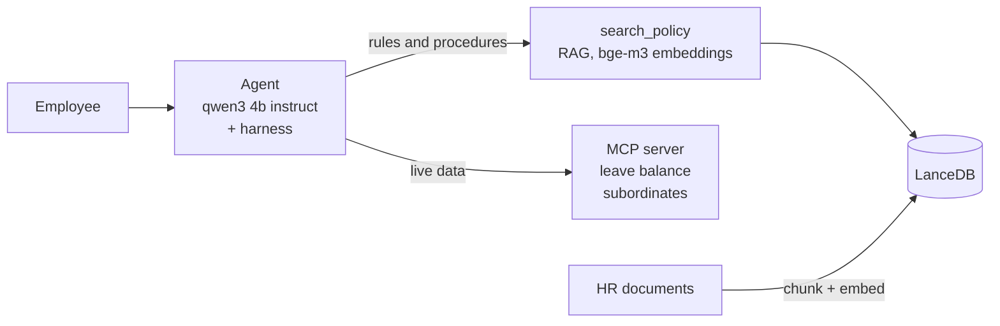

# HR Assistant Agent

An internal HR chatbot that runs fully on your machine. It answers policy questions from HR documents (RAG) and looks up live employee data, such as leave balance and subordinates, through an MCP server.

## Quick start

Requirements: Node.js 22+ and [Ollama](https://ollama.com).

```bash
ollama pull qwen3:4b-instruct
ollama pull bge-m3
npm install
npm run ingest                        # index data/hr-policies.md into LanceDB
npm run ui                            # open http://localhost:4310
```

Optional: copy `.env.example` to `.env` to change models, thresholds, or timeouts. Set `PORT` to change the UI port.

## Commands

| Command | What it does |
| --- | --- |
| `npm run ingest` | Chunks and embeds the HR documents into the vector store |
| `npm run ui` | Starts the web chat at `http://localhost:4310` |
| `npm run chat -- --employee-id E002` | Starts the terminal chat as an employee (E001–E006) |
| `npm run eval` | Runs 33 end-to-end checks against the real models (~50 s) |
| `npm test` | Runs the tests (retrieval tests need Ollama and `npm run ingest`) |
| `npm run typecheck` | Type-checks the project |
| `npm run mcp` | Starts the MCP server on its own (the agent starts it automatically) |

## Project structure

```
data/
  hr-policies.md     HR policy document used as the knowledge base
src/
  agent/             Agent loop (harness), tools, follow-up handling, terminal chat
  rag/               Chunking, ingestion, retrieval, and relevance check
  mcp/               MCP server, client, and dummy employee data
  ui/                Web server and chat page
  eval/              End-to-end evaluation cases and runner
  config.ts          Settings read from .env
  directory.ts       Employee names and titles (identity only)
  ollama.ts          Ollama chat and embedding client
```

Tests sit next to the file they test (`*.test.ts`).

## How it works



The model picks a tool from the tool descriptions: `search_policy` for rules, MCP tools for a person's data, and both when a question needs both.

**Harness.** The agent loop stops after 5 iterations with a safe fallback, refuses repeated tool calls, and retries a failed call once. If the model answers without evidence, the harness searches the documents itself. If nothing relevant is found, it replies "not covered, contact HR". Access to another employee's data is checked in code before the tool runs.

## Tech choices

- **qwen3:4b-instruct on Ollama:** HR data never leaves the machine, and there is no API key or usage cost. It is a small model that makes mistakes, so the harness checks its work.
- **bge-m3:** Open-source and multilingual, so it handles Indonesian documents well. Correct chunks score clearly above off-topic ones, which makes a similarity threshold workable.
- **LanceDB:** Embedded and file-based, so there is no database server to run. Production would move to pgvector for access control and backups.
- **MCP over stdio:** The agent starts the server as a child process, so there is no port or auth to set up. The tools can later move to a real HR system without changing the agent.

## Trade-offs

- **800-character chunks with 100 overlap, cut at headings:** a rule stays together with its numbers, at the cost of some repeated text.
- **Similarity threshold 0.59:** a wrong "not covered" is better than a confident wrong answer.
- **5 KB sample corpus:** 200 pages of PDF would need text extraction and a re-measured threshold.

## Evaluation

`npm run eval` runs 33 smoke checks, and all of them pass. For production I would add recall@k, groundedness, HR-reviewed correctness, refusal rate, and a data-leak red team, all running in CI.
