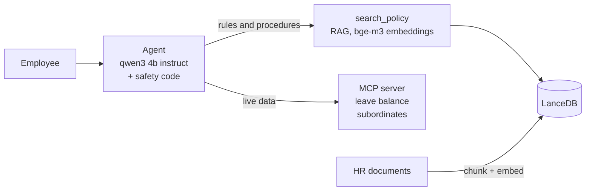

# HR Assistant Agent

A chatbot that answers employee HR questions from the company's policy documents, and can look up live data like leave balance. It runs fully on your own machine (no cloud, no API key).

**Think of a front-desk assistant** who (1) checks the rulebook for policy questions, (2) phones HR for personal data, and (3) has a supervisor who stops mistakes. In this project those are **RAG** (search the documents), **MCP tools** (a standard way for the agent to call functions), and the **harness** (safety code around the model).

```bash
ollama pull qwen3:4b-instruct && ollama pull bge-m3    # needs Node.js 22+ and Ollama
npm install && npm run ingest                          # read the HR document into the vector store
npm run chat -- --employee-id E002                     # talk to it (add --ask "..." for one question)
npm run eval                                           # 13 automatic checks, ~15 s
npm run ui                                             # optional browser demo at http://localhost:4310 (PORT=4311 to change)
```

The browser demo shows the steps and sources behind each answer and lets you switch the asking employee to try the access control. It only answers requests addressed to localhost, and the README is served at /readme.

## 1. Architecture



**How the agent picks:** the model sees three tools and chooses one per step. Questions about *rules* go to document search, questions about *a person's data* go to MCP, and some need both ("my leave balance and the carry-over rule"). If the documents have no answer, it gives one fixed, polite reply ("the information is not in the HR policy documents, please contact the HR team") instead of guessing. The harness enforces this: when the document search finds nothing and no HR data backs the answer, whatever the model wrote is replaced by that reply.

| Part | Choice | Why |
|---|---|---|
| LLM | `qwen3:4b-instruct` (Ollama) | HR data stays on the machine. It supports tool calling and handles Indonesian well enough. Use the `-instruct` tag: plain `qwen3:4b` is a "thinking" model that leaks its reasoning and was ~15x slower. |
| Embeddings | `bge-m3` | Understands Indonesian. It ranked the right section first for 20 of 20 test questions. |
| Vector store | LanceDB | A folder on disk, nothing to run. Enough for a few thousand chunks. |
| Tools | MCP over stdio | The agent can only call tools through the protocol, so the server can move elsewhere later. |
| Loop | Hand-written, no framework | Short and easy to trace and test. |

**The harness** is where I put everything that must not depend on the model behaving well:
- Stop after 5 steps, ignore repeated identical tool calls, time out and retry once.
- If the model answers without looking anything up, nudge it once, then run the document search for it.
- Before a data tool runs, check the asker may see that person (themselves or their team). This is code, not a prompt rule, so it cannot be talked around. In the demo the employee ID is a CLI flag; in production it would come from the login session.

## 2. Trade-offs

- **Chunk = 800 characters, 100 overlap, cut at headings.** Each policy section is short and holds one rule with its numbers. Bigger chunks mix rules together; smaller ones split a rule from its exception. Cost: a little repeated text.
- **Search must score above 0.59 to count.** I measured it: right sections scored 0.62-0.75, off-topic questions at most 0.56. I prefer a wrongly polite "not covered" over a confident wrong answer in HR. Cost: the gap is narrow, so re-measure on the real 200-page corpus.
- **LanceDB now, pgvector later.** LanceDB needs no setup for a demo. In production pgvector keeps vectors next to existing data, with access control and backups.
- **Small local model.** Private and free, but careless: it skipped searching, compared numbers wrongly, and stopped searching once chat history was replayed (0/5 right, versus 5/5 when history is a short note). The harness fixed each one, so a bigger model is an upgrade, not a requirement.
- **Document search is a tool the model chooses**, not always-on. It saves a search for pure data questions. Cost: the model sometimes skips it, hence the forced search.

## 3. Evaluation

**Today:** `npm run eval` runs 13 checks (right section found, right fact, right tool, the polite not-covered reply, flagged by the harness, for out-of-scope questions, access blocked). All pass, and it fails when I loosen the guardrail on purpose. It is a small smoke test, not a benchmark.

**What I would add for production:**
1. **Retrieval quality:** is the right passage in the top results? (recall@k, MRR on a few hundred labelled questions.)
2. **Groundedness:** a judge model checks every claim is backed by the retrieved text.
3. **Correctness:** HR-reviewed question/answer pairs, scored on facts, numbers and dates.
4. **Declining correctly:** how often it answers confidently when it should refuse (the key safety number).
5. **Tool use and safety:** right tool and arguments, plus a red team trying to read other people's data (target: zero leaks).
6. **Always running:** run all of this in CI on every prompt, model or document change, and track thumbs up/down, "asked HR anyway", and unanswered questions in production.

More detail for each build step is in `.scratch/hr-assistant-agent/issues/`.
