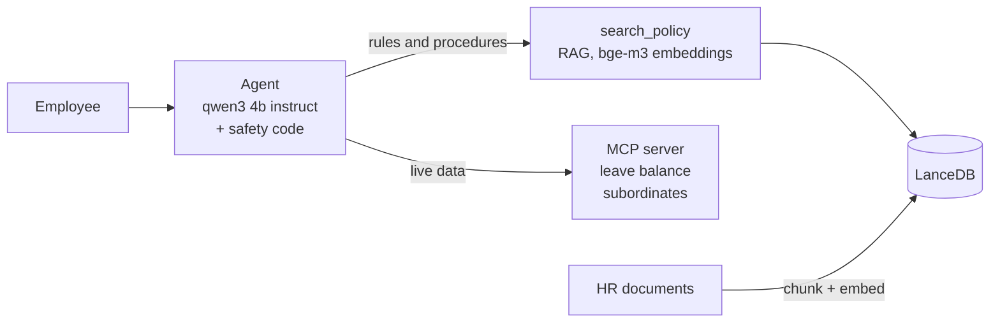

# HR Assistant Agent

A chatbot that answers employee HR questions from policy documents (RAG) and looks up live data like leave balance (MCP tools). It runs fully on your machine: no cloud, no API key.

```bash
ollama pull qwen3:4b-instruct && ollama pull bge-m3    # needs Node.js 22+ and Ollama
npm install && npm run ingest                          # load the HR document into the vector store
npm run chat -- --employee-id E002                     # talk to it (add --ask "..." for one question)
npm run eval                                           # 33 automatic checks, ~40 s
npm run ui                                             # optional browser demo at http://localhost:4310
```

## Architecture



**Flow:**
1. The employee asks a question.
2. The model picks a tool: document search for *rules*, MCP for *a person's data*, or both.
3. Before a data tool runs, the harness checks the asker may see that person (themselves or their team).
4. The tool result goes back to the model, which writes the answer.
5. If nothing backs the answer, the harness replaces it with a polite "not covered, contact HR" reply.

Stack: `qwen3:4b-instruct` (Ollama), `bge-m3` embeddings, LanceDB, MCP over stdio.

## Trade-offs

- **Chunks of 800 characters, 100 overlap, cut at headings.** Keeps one rule with its numbers; costs a little repeated text.
- **Relevance threshold 0.59, near misses (0.50-0.59) double-checked by the model.** Colloquial questions and off-topic ones score too close for a plain cut-off. On this corpus the check accepted 9/9 covered and rejected 11/11 uncovered questions. I prefer a wrong "not covered" over a confident wrong answer. Needs re-measuring on the real corpus.
- **Small local model.** Private and free, but careless; the harness fixes its mistakes. A bigger model is an upgrade, not a requirement.
- **LanceDB now, pgvector later** for access control and backups next to existing data.

## Evaluation

`npm run eval` runs 33 checks (right section, right fact, right tool, follow-ups, typos, wording, polite refusal, access blocked). All pass. It is a smoke test, not a benchmark.

For production I would add: retrieval quality (recall@k, MRR), groundedness (judge model), HR-reviewed correctness, refusal rate, a red team for data leaks (target: zero), and all of it in CI plus user feedback tracking.

More detail per build step: `.scratch/hr-assistant-agent/issues/`.
