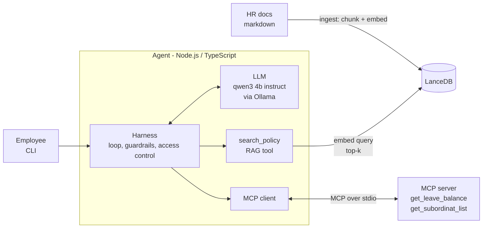

# HR Assistant Agent (RAG + MCP + Tool Calling)

An internal HR chatbot that answers from HR policy documents (RAG) and checks live data through MCP tools (leave balance, subordinates). It runs fully local on Ollama: no cloud account or API key.

Needs Node.js 22+ and [Ollama](https://ollama.com).

```bash
ollama pull qwen3:4b-instruct && ollama pull bge-m3
npm install
npm run ingest                                 # chunk + embed + store the sample HR doc
npm run chat -- --employee-id E002             # interactive CLI (add --ask "..." for one question)
npm run eval                                   # 13 eval cases against the real models
npm test                                       # 55 tests (needs Ollama + ingest)
```

Demo users: `E001` (head), `E002` (manager of `E003`, `E004`, `E005`). Answers are in Indonesian.

## 1. Architecture



**RAG vs MCP:** there is no hand-written router. The LLM sees three tools, `search_policy` (RAG over documents), `get_leave_balance` and `get_subordinat_list` (MCP), and picks per step through tool calling. Rules and procedures go to RAG, live employee data goes to MCP, and a question needing both (e.g. "my leave balance and the carry-over rule") calls both.

| Component | Choice | Why |
|---|---|---|
| LLM | `qwen3:4b-instruct` on Ollama | HR data stays on the machine, and Qwen3 has native tool calling and acceptable Indonesian at laptop size. The plain `qwen3:4b` tag is now a thinking build that leaks its reasoning and was ~15x slower, so use the instruct variant. |
| Embeddings | `bge-m3` | Multilingual, so it retrieves Indonesian text far better than English-centric models. It ranked the right section first for 20/20 test questions. |
| Vector store | LanceDB | Embedded (a folder on disk), supports cosine search and metadata, no server to run. Enough for a few thousand chunks. |
| MCP | stdio, separate process | The agent only uses `listTools`/`callTool`, never imports the tool code, so the server can later move to a remote transport. |
| Agent loop | hand-written, no framework | The task is about loop and harness engineering, and a small explicit loop is easier to trace and test. |

**Harness (loop engineering use case)** wraps the agent loop with controls that must not depend on model behaviour, each proven by a test that forces it:

- **Iteration cap** (default 5) with a safe fallback answer, and a **duplicate-call guard** for identical repeated tool calls.
- **Timeouts and one retry** for model and tool calls.
- **"Tidak tahu" guardrail:** retrieval returns nothing below a similarity gate, and the prompt requires the fixed refusal. If the model answers without calling any tool, it is nudged once, then the harness runs the document search itself.
- **Access control in code:** before a data tool runs, the harness checks the target is the user or one of their subordinates (via MCP). A prompt rule can be injected away, a code check cannot. The demo takes the employee ID from `--employee-id`; production would take it from an authenticated session.
- **Trace** of every step, printed in the CLI.

## 2. Trade-offs

- **Chunk size 800 chars, 100 overlap, split on Markdown headings.** Policy sections are short and self-contained, so a chunk usually holds one rule with its numbers. Bigger chunks dilute the embedding with unrelated rules and waste a small model's context; smaller ones separate a rule from its exception. The heading path is prefixed to each chunk for context. Cost: some duplicated text from overlap.
- **Top-k = 4 and a similarity gate of 0.59.** Measured, not guessed: correct chunks scored 0.62-0.75, off-topic best chunks up to 0.56, and 0.59 sits in that gap. The gate looks at the best chunk only, since lower-ranked chunks of a multi-section question usually score under the threshold themselves. I prefer a false "tidak tahu" over a confident wrong answer in HR, but the gap is narrow (~0.03), so it must be re-measured on the real 200-page corpus.
- **LanceDB over pgvector/Chroma.** Zero setup for a local demo. For production I would use pgvector, to keep vectors next to existing data with access control and backups.
- **Small local model.** Private, free and offline, but weaker at multi-step tool use. It skipped the document search or compared numbers wrongly until the harness fixed it, and replaying full chat history made it stop searching (0/5 correct, versus 5/5 when history is passed as a short system note). The harness does the safety work so a bigger model is an upgrade, not a requirement.
- **RAG as a tool instead of always retrieving.** Saves a retrieval on pure data questions and supports multi-step questions, at the cost of the model sometimes skipping it (hence the forced search).

## 3. Evaluation

**Today (`npm run eval`):** 13 rule-based cases pass (13/13, ~15 s): retrieval hits, RAG facts, correct tool routing, multi-tool, "tidak tahu" on out-of-scope questions, and access control. The suite does fail when the guardrail is loosened. It is a smoke test: regex checks, single-turn, and a strict refusal phrase.

**What I would add in production:**

1. **Retrieval quality:** recall@k and MRR on several hundred real, labelled questions, tracked on every chunking or embedding change.
2. **Groundedness:** an LLM-as-judge (calibrated on human-labelled samples) checks that every claim in the answer is supported by the retrieved passages, plus citation accuracy.
3. **Answer correctness:** golden Q&A reviewed by HR, scored on facts, numbers and dates.
4. **Abstention quality:** precision/recall of "tidak tahu" on answerable vs unanswerable questions. The false-confident-answer rate is the headline safety metric.
5. **Tool use:** right tool, right arguments, no wasted calls, measured on recorded traces. Include multi-turn, paraphrase and typo sets, since history handling was the biggest source of failures here.
6. **Safety red team:** prompt injection and attempts to read other employees' data, with a target of zero leaks.
7. **CI gate and online signals:** run the suite on every prompt, model, chunking or document change and block regressions. In production track thumbs up/down, "asked HR anyway" rate, unanswered questions (they reveal document gaps), latency, cost and tool errors.

Detailed findings for each build step are in `.scratch/hr-assistant-agent/issues/`.
